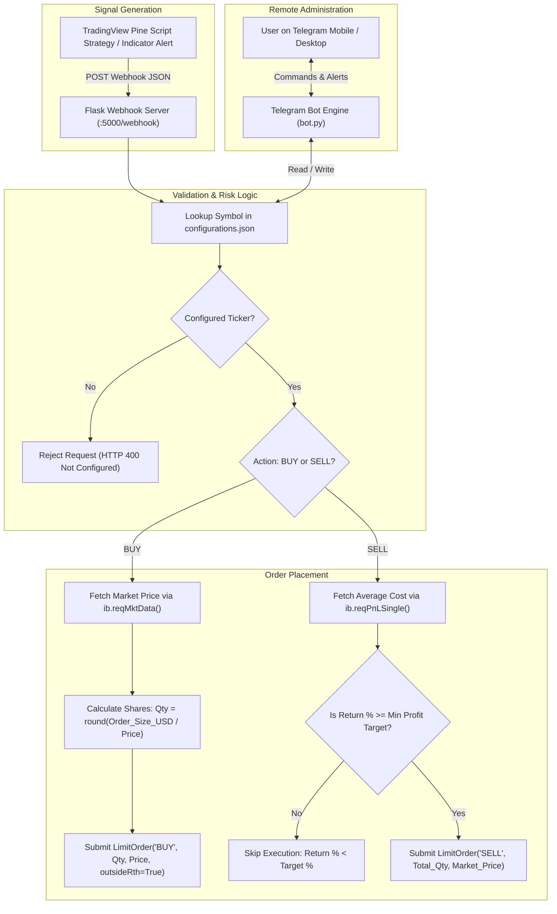
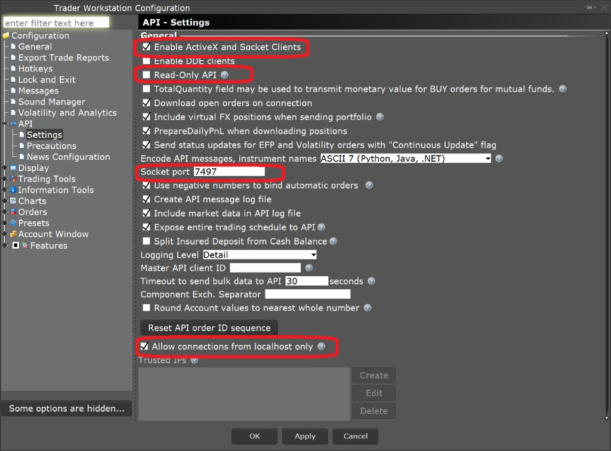

# 📱 IBKR Telegram Trading Bot & TradingView Webhook Engine

[](https://python.org)
[](https://interactivebrokers.com)
[](https://flask.palletsprojects.com)
[](https://core.telegram.org/bots)
[](https://opensource.org/licenses/MIT)

> An automated execution pipeline linking **TradingView Pine Script alerts** directly to **Interactive Brokers (IBKR)** via high-speed Flask webhooks, controlled dynamically by a real-time **Telegram bot interface** with order simulations, portfolio profit targets, and GTC execution outside regular trading hours.

---

### 💼 Need Custom TradingView Webhook Bots, IBKR Automations, or Telegram Terminals?
I build custom webhook listeners, broker execution routers, low-latency trading software, and automated risk systems.
* 💬 **Telegram:** [@JanzebBlockdev](https://t.me/JanzebBlockdev)
* 💼 **Fiverr Profile:** [Verified Quantitative Developer (Fiverr)](https://tinyurl.com/2wruxnsx)
* 📧 **Email:** `jahanzaibchanna70@gmail.com`

---

## 📑 Table of Contents
1. [Key Architectural Highlights](#-key-architectural-highlights)
2. [End-to-End Execution Pipeline](#-end-to-end-execution-pipeline)
3. [Telegram Command Reference](#-telegram-command-reference)
4. [TradingView Alert Configuration](#-tradingview-alert-configuration)
5. [Prerequisites & TWS / Gateway Setup](#-prerequisites--tws--gateway-setup)
6. [Installation & Deployment](#-installation--deployment)
7. [Explore Other Quantitative Projects](#-explore-other-quantitative-projects)
8. [Disclaimer](#-disclaimer)

---

## 🚀 Key Architectural Highlights

* **Concurrent Multi-Threaded Core:** Runs the asynchronous Telegram bot listener alongside a low-latency Flask webhook HTTP server without event loop collision.
* **Dynamic Telegram Configuration:** Adjust order size allocations (\$ USD) and minimum profit thresholds (%) per ticker in real-time without restarting the bot.
* **Profit-Guarded Selling:** On webhook `sell` signals, automatically computes realized position cost basis (`reqPnLSingle`) and verifies if `return_pct >= min_profit_percent` before firing limit orders.
* **Outside RTH Execution:** Submits limit orders with `outsideRth=True` and `tif='GTC'` so trades fill in pre-market, regular hours, or after-hours.
* **Test Simulation Mode:** Emulate order submissions, verify webhook connectivity, and calculate lot sizing without risking live capital.

---

## 🏛️ End-to-End Execution Pipeline



---

## 📱 Telegram Command Reference

Control your trading engine remotely via direct Telegram messages:

| Command | Syntax | Description |
| :--- | :--- | :--- |
| `/start` | `/start` | Displays initialization menu and available commands. |
| `/set` | `/set <TICKER> <USD_AMOUNT> <PROFIT_%>` | Configures order allocation and profit target. (e.g., `/set AAPL 1000 5.0`). |
| `/show` | `/show` | Displays all actively monitored tickers and parameters. |
| `/test_order` | `/test_order <TICKER> <BUY/SELL> <PRICE> <QTY> <YYYY-MM-DD>` | Simulates an execution card and calculates total capital. |

### Example Telegram Interactions:

```
User:   /set NVDA 1500 7.5
Bot:    ✅ Saved: NVDA | $1500.0 | Target: 7.5%

User:   /show
Bot:    📊 Configurations:
        🔹 AAPL: $1000.0 @ 5.0%
        🔹 NVDA: $1500.0 @ 7.5%

User:   /test_order TSLA BUY 210.50 10 2026-11-07
Bot:    🧪 Test Order:
        📅 2026-11-07
        📈 TSLA
        📥 BUY
        💵 $210.50
        🔢 Qty: 10
        🧾 Total: $2105.00
```

---

## 📡 TradingView Alert Configuration

Configure TradingView webhooks to trigger instant automated orders:

1. In TradingView, create a new Alert on your desired chart.
2. Under **Notification**, check ✅ **Webhook URL** and enter your server address:
   ```
   http://YOUR_SERVER_IP:5000/webhook
   ```
   *(For local testing without a static IP, use **ngrok**: `ngrok http 5000`)*.

3. Under **Message**, paste the following JSON payload:

**For Buy Alerts:**
```json
{
  "ticker": "{{ticker}}",
  "action": "buy"
}
```

**For Sell Alerts:**
```json
{
  "ticker": "{{ticker}}",
  "action": "sell"
}
```

---

## ⚙️ Prerequisites & TWS / Gateway Setup

1. **Python 3.10+** installed.
2. **Interactive Brokers TWS or IB Gateway** running on port `7497` (Paper) or `7496` (Live).
3. In TWS, go to **Global Configuration $\rightarrow$ API $\rightarrow$ Settings**:
   * Enable ✅ **"Enable ActiveX and Socket Clients"**.
   * Uncheck ❌ **"Read-Only API"**.
   * Add `127.0.0.1` to **Trusted IPs**.
   * Enable ✅ **"Allow connections from localhost only"**.
4. Telegram Bot Token from [@BotFather](https://t.me/BotFather).

<p align="center">
  
</p>

---

## 🛠️ Installation & Deployment

1. **Clone the repository:**
   ```bash
   git clone https://github.com/jahanzaib-codes/ibkr-telegram-trading-bot.git
   cd ibkr-telegram-trading-bot
   ```

2. **Install dependencies:**
   ```bash
   pip install -r requirements.txt
   ```

3. **Configure Bot Credentials:**
   Edit `bot.py` or create a `.env` file with your credentials:
   ```python
   TELEGRAM_TOKEN = "YOUR_BOT_TOKEN_HERE"
   TELEGRAM_USER_ID = 123456789  # Your numeric Telegram Chat ID
   ```

4. **Launch the Service:**
   ```bash
   python bot.py
   ```
   *The Telegram polling bot and Flask webhook server will launch simultaneously. A test signal notification will arrive in Telegram within 5 seconds.*

---

## ⭐ Explore Other Quantitative Projects

* 🧠 **[Interactive Brokers AI 0DTE Options Bot & GUI](https://github.com/jahanzaib-codes/ibkr-ai-trading-bot-gui)** — ML-driven options execution terminal with XGBoost and Tkinter.
* 📉 **[IBKR Automated Trailing Stop Orders](https://github.com/jahanzaib-codes/ibkr-trailing-orders)** — CSV batch trailing stop limit order dispatcher with loss prevention.
* 📊 **[Real-Time NASDAQ Screener & ATR Bot](https://github.com/jahanzaib-codes/RealTime-ATR-Screener-Trader)** — Polygon.io WebSocket screener and chandelier execution engine.
* ⚡ **[Solana Pump.fun 0-Block Sniper Bot](https://github.com/jahanzaib-codes/solana-pumpfun-sniper-bot)** — Ultra low-latency meme coin sniper with Jito MEV bundles.

---

## ⚠️ Disclaimer

*This software is intended for educational, algorithmic research, and demonstration purposes. Live trading involves substantial risk of loss. Always test order execution extensively on Paper Trading accounts before committing live capital.*

---
*Maintained by **Jahanzaib** ([@jahanzaib-codes](https://github.com/jahanzaib-codes))*
